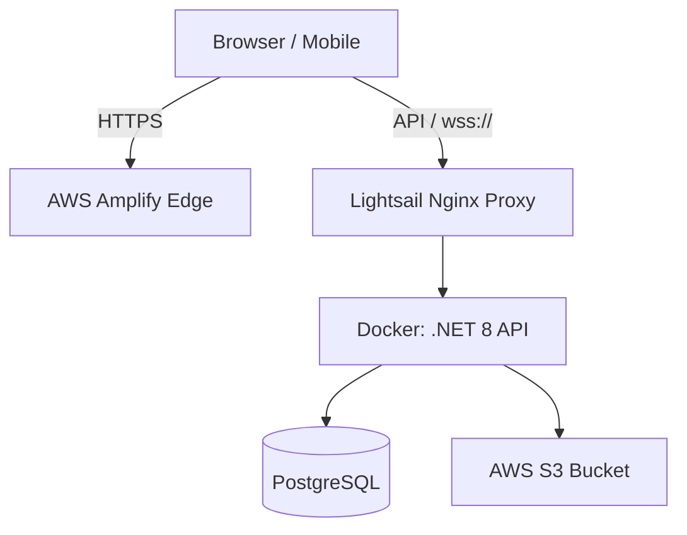

# TABLO — AI Project Context

## 0. AI READ-FIRST NOTICE

**This document describe the current TABLO project.**

Before making any change to this repository:
- **Understand the existing architecture.**
- **Inspect the relevant source code.**
- **Preserve existing flows.**
- **Preserve existing structure.**
- **Make the smallest safe change.**
- **Do not assume historical documentation is current.**

**CURRENT CODE + VERIFIED CURRENT DOCUMENTATION = SOURCE OF TRUTH.**

---

## 1. PROJECT IDENTITY
- **Project Name:** TABLO
- **Product Type:** Multi-tenant restaurant QR ordering and table management system.
- **Primary Purpose:** Replace physical menus and traditional waiter ordering with a digital, contactless experience via QR codes.
- **Target Users:** Anonymous Customers (Diners), Waiters, Kitchen Staff, Restaurant Admins, System SuperAdmins.
- **Core Business Problem:** Streamlining the restaurant ordering lifecycle, reducing waiter round-trips, and increasing order accuracy.
- **Current Production Status:** Actively deployed to production.

## 2. PROJECT PRINCIPLES
- Preserve existing flows and business logic.
- Preserve existing architecture (Vite SPA + .NET 8 API).
- Make minimal, targeted changes.
- Avoid unrelated refactoring or changing working behavior.
- Maintain backward compatibility of API contracts.
- Do not introduce unnecessary or unapproved dependencies.
- Prioritize production safety.
- **Enforce strict tenant isolation.**
- Security-first handling of secrets (no hardcoding, no tracking in Git).

## 3. TECHNOLOGY STACK

| Category | Technology |
| :--- | :--- |
| **Frontend** | React 19, Vite, TanStack Router, TailwindCSS |
| **Backend** | ASP.NET Core 8 Web API |
| **Database** | PostgreSQL |
| **ORM** | Entity Framework Core 8 |
| **Authentication** | JWT (JSON Web Tokens), BCrypt |
| **Authorization** | Claim-based & Role-based middleware |
| **Validation** | ASP.NET DataAnnotations |
| **Real-time** | ASP.NET Core SignalR (WebSockets) |
| **Object Storage** | AWS S3 (Production) / Local (Dev) |
| **Hosting** | AWS Amplify (Frontend) / AWS Lightsail (Backend) |
| **Containerization** | Docker |
| **Reverse Proxy** | Nginx |
| **Testing** | xUnit, Python E2E Scripts |
| **Build Tooling** | `npm` (Frontend), `.NET CLI` (Backend) |

## 4. CURRENT ARCHITECTURE

**CRITICAL NOTE:** Older documentation describes a Cloudflare / Nitro / SSR custom server architecture. **This is historical and obsolete.** The current architecture is a statically deployed React SPA hosted on AWS Amplify. **MUST NOT** be treated as the current production architecture.

## 5. REPOSITORY STRUCTURE
- `tablo/` — Frontend React SPA.
- `Tablo.Api/` — Backend ASP.NET Core API.
- `Tablo.Api/Controllers/` — HTTP routing layer.
- `Tablo.Api/Entities/` — EF Core domain models and tenant keys.
- `Tablo.Api/Services/` — Business logic.
- `Tablo.Api/Migrations/` — EF Core database migrations.
- `Tablo.Api/Dockerfile` — Backend container configuration.
- `nginx-default.conf` — Nginx proxy and WebSocket settings.
- `amplify.yml` — AWS Amplify frontend CI/CD configuration.
- `docs/` — Authoritative project documentation.

## 6. FRONTEND CONTEXT
- **React + Vite:** Single Page Application (SPA).
- **TanStack Router:** Handles all client-side routing.
- **API Client:** React Query is used for data fetching, caching, and state management.
- **Authentication:** Ephemeral JWTs stored client-side.
- **SignalR:** Handled via custom React hooks (`@microsoft/signalr`) to monitor orders.
- **Environment Configuration:** Driven by `.env` (e.g., `VITE_API_URL`).
- **Production Hosting:** AWS Amplify.

## 7. BACKEND CONTEXT
- **ASP.NET Core 8:** Kestrel web server running in Docker.
- **Controllers & Services:** Clean separation of concerns.
- **EF Core:** Handles all PostgreSQL interactions.
- **Validation:** Enforced via DTO DataAnnotations.
- **Authentication:** JWT Bearer tokens validated via middleware.
- **Authorization:** `[Authorize(Roles = "...")]` attributes restrict access.
- **Middleware:** Global error handling and strict CORS policies.
- **SignalR:** Hosted at `/hubs/order` for real-time WebSockets.
- **S3:** Integrated via `IImageStorageService` abstraction.

## 8. DATABASE CONTEXT
- **PostgreSQL:** Primary relational store.
- **EF Core DbContext:** `ApplicationDbContext`.
- **Migrations:** Applied out-of-band manually. Never run on startup.
- **Tenant Relationships:** Practically every entity belongs to a `Restaurant` (Tenant).
- **Order Relationships:** `Order` contains multiple `OrderItem` objects.

## 9. MULTI-TENANCY
**CRITICAL AI RULE: NEVER WEAKEN OR BYPASS TENANT ISOLATION.**
- **RestaurantId:** The primary tenant identifier.
- **Tenant Identity:** Extracted securely from the JWT claim (`User.GetRestaurantId()`).
- **Tenant-Scoped Requests:** Every single database query must filter by `RestaurantId` if the resource is tenant-specific.
- **Authorization:** Controllers explicitly check: `if (User.GetRestaurantId() != request.RestaurantId) return Forbid();`
- **Isolation:** There is no cross-tenant data sharing.

## 10. AUTHENTICATION & AUTHORIZATION
- **JWT:** Stateless JSON Web Tokens.
- **Roles:** `Admin`, `Kitchen`, `Waiter`.
- **Claims:** Embeds identity (`sub`) and `RestaurantId`.
- **Flow:** `/api/auth/login` → validates credentials → returns JWT.
- **Protected Endpoints:** Require Authorization headers.
- **Password Reset:** Generates and emails verification OTPs.

## 11. CORE BUSINESS FLOWS
1. SuperAdmin creates a Restaurant and RestaurantAdmin.
2. RestaurantAdmin sets up Categories, Menu Items, and Tables.
3. System generates QR Tokens for Tables.
4. Customer scans QR → Frontend resolves Context (Restaurant + Table).
5. Customer adds items to Cart → Checks out.
6. Order becomes `Placed`.
7. Kitchen updates to `Preparing` → `Ready`.
8. Waiter delivers and updates to `Served`.
9. Waiter natively handles physical payment collection.

## 12. QR / TABLE CONTEXT
- **Table:** Represents physical seating capacity.
- **QR:** Encodes a unique frontend URL.
- **QR Token:** Cryptographically random string identifying the table without exposing DB IDs.
- **Anonymous Table Resolution:** The frontend calls the API with the token to establish a customer's `RestaurantId` and `TableId` session context.

## 13. ORDER CONTEXT
- **Order:** Tracks total order state.
- **Order Items:** Line items detailing the specific menu item, quantity, and snapshotted price.
- **Totals:** Subtotal, Tax, Discount, TotalAmount.
- **Payment Status:** Monitored strictly for reporting, not processed digitally.
- **Order Lifecycle States:** `Placed` → `Preparing` → `Ready` → `Served` (also: `cancelled`, `rejected`).

## 14. KITCHEN / WAITER / BILLING
- **Kitchen:** Live dashboard monitoring `Placed` and `Preparing` orders.
- **Waiter:** Live dashboard monitoring `Ready` orders. Receives "Call Waiter" service requests.
- **Service Requests:** Customers ping waiters. Waiters `Acknowledge` and `Complete` them.
- **Billing:** The waiter physical totals active orders for a specific table to request physical payment.

## 15. SIGNALR CONTEXT
- **Hub:** Endpoint `/hubs/order`.
- **Events:** `ReceiveOrderUpdate` broadcasts state changes.
- **Client Connection:** React client connects on load.
- **Authentication:** Injects `?access_token=<JWT>` into the query string for initial handshake validation.
- **Production WebSocket Requirements:** Nginx requires explicit `Connection: Upgrade` headers.

## 16. S3 / IMAGE CONTEXT
- **Storage Abstraction:** Handled by `IImageStorageService`.
- **Local Storage:** `LocalImageStorageService` (for dev).
- **S3 Production Storage:** `S3ImageStorageService` uploads to AWS S3, returning the CDN URL saved to the DB. Images can be uploaded, retrieved, and deleted.

## 17. PAYMENT CONTEXT
**IMPORTANT:** DO NOT ASSUME DIGITAL PAYMENT PROCESSING IS ACTIVE.
- The current verified repository has **no active external payment provider** (e.g., Stripe, PayPal) integrated into the core checkout flow.
- Financial numbers are logged natively. Payment is handled physically by waitstaff.

## 18. PRODUCTION CONTEXT
- **AWS Region:** e.g., `ap-south-1` (varies by deployment).
- **Amplify:** Serves the static SPA.
- **Lightsail:** Ubuntu VM hosting Nginx + Docker.
- **Docker:** Runs the `.NET` API on port 8080 internally.
- **Nginx:** Terminates HTTPS and proxies to Docker.
- **PostgreSQL:** Managed DB isolated from public access.
- **S3:** Hosts menu imagery.
- **SignalR:** Handled via WSS over HTTPS.

## 19. DEPLOYMENT CONTEXT
- **Frontend Deployment:** Automated AWS Amplify CI/CD via the `production` branch.
- **Backend Deployment:** Manual SSH process (Git Pull → Docker Build → Docker Run).
- **Migrations:** Applied manually via `.NET EF CLI` against the production database connection string. Never run on startup.
- **Rollback:** Restoring previous Docker image tags and reverting frontend Amplify builds.
*(See `docs/deployment/PROJECT_DEPLOYMENT_DOCUMENTATION.md` for full steps).*

## 20. GIT CONTEXT
- **`dev`:** Active development integration branch.
- **`production`:** Live release branch. Merging here triggers the frontend deployment.
- **Clean Working Tree:** Required before pulling or merging.
- **IMPORTANT PROJECT RULE:** DO NOT COMMIT UNTIL THE RELEVANT WORK HAS BEEN VERIFIED AND PRODUCTION SUCCESS/APPROVAL HAS BEEN ACHIEVED WHERE APPLICABLE.

## 21. CURRENT PRODUCTION STATE
- System is stable, actively routing QR traffic, multi-tenant isolation is strict, and real-time SignalR notifications successfully broadcast across the Nginx proxy to Kitchen and Waiter clients.

## 22. KNOWN LIMITATIONS
- No verified external digital payment provider in the core flow.
- SignalR requires an active browser tab (no background push notifications for locked mobile devices).
- Backend deployment is semi-manual via SSH.

## 23. DEFERRED WORK
- Implementing automated GitHub Actions / ECR CI/CD for the backend Lightsail container update.

## 24. SECURITY RULES
**THE AI MUST NEVER:**
- Expose passwords.
- Expose DB credentials.
- Expose JWT secrets.
- Expose AWS credentials.
- Expose SSH private keys.
- Commit secrets to Git.
- Place real credentials into any documentation.
- Print secret values in logs.
- Bypass authentication logic.
- Weaken authorization requirements.
- Weaken tenant isolation boundaries.

## 25. PRODUCTION SAFETY RULES
**THE AI MUST NOT:**
- Deploy automatically without permission.
- Modify production infrastructure without explicit authorization.
- Run destructive production DB commands (e.g., `DROP`, `DELETE` without `WHERE`).
- Run migrations against production without explicit approval.
- Delete AWS resources.
- Restart production services unnecessarily.
- Modify production environment variables casually.
- Rotate credentials without explicit approval.

## 26. APPLICATION CHANGE RULES
**"DO NOT TOUCH MY PROJECT FLOWS AND STRUCTURE."**

Interpretation:
- Preserve existing application flows.
- Preserve existing business logic.
- Preserve existing API contracts (don't break frontend clients).
- Preserve database structure unless explicitly required.
- Preserve frontend routing (TanStack).
- Preserve existing architecture.
- Avoid unrelated refactoring (do not "clean up" adjacent code casually).
- Avoid changing working behavior.
- **Make the smallest change necessary.**
- If a requested task requires architectural changes, explain the impact clearly before acting.

## 27. AI INVESTIGATION PROTOCOL
Before changing anything:
1. Understand the user request.
2. Identify the affected layer.
3. Inspect the repository.
4. Locate existing implementation.
5. Trace dependencies (Frontend ↔ Backend ↔ DB).
6. Determine whether the requested change already exists.
7. Identify possible side effects.
8. Plan the smallest change.
9. Make only the required modification.
10. Run relevant tests.
11. Build where appropriate.
12. Verify behavior.
13. Report exactly what changed.

## 28. AI CHANGE CLASSIFICATION
Before making a change, classify it as:
- **A. Documentation-only**
- **B. Frontend**
- **C. Backend**
- **D. Database**
- **E. Infrastructure**
- **F. Deployment**
- **G. Security**
- **H. Cross-layer**

*Explain which category applies. For infrastructure, deployment, database, and security changes, require extra verification.*

## 29. AI APPROVAL GATES

### Gate 1 — Understand
Inspect the codebase and documentation before suggesting changes.

### Gate 2 — Plan
Explain what will change and why.

### Gate 3 — Implement
Make the smallest safe change.

### Gate 4 — Verify
Run relevant tests/builds to ensure nothing broke.

### Gate 5 — Production
**Never deploy automatically.** Before production deployment, explicitly confirm that:
- No application/code/configuration/migration modification is pending.
- All intended changes are ready and tested.
- Production deployment is explicitly authorized by the user.

### Gate 6 — Commit
**Do not commit prematurely.** Commit only after the required verification/production success and explicit user authorization.

## 30. AI OUTPUT REQUIREMENTS
When reporting work, state:
1. What was inspected.
2. What was changed.
3. Why it was changed.
4. What was NOT changed.
5. Tests performed.
6. Build result.
7. Deployment status.
8. Git status.
9. Any risks or remaining issues.
**Never claim success without evidence.**

## 31. DOCUMENTATION MAP
- **Technical:** `docs/architecture/PROJECT_TECHNICAL_DOCUMENTATION.md` (Deep dive into code and architecture implementation).
- **Flows:** `docs/flows/PROJECT_FLOW_DOCUMENTATION.md` (Detailed step-by-step business flows and object lifecycles).
- **Deployment:** `docs/deployment/PROJECT_DEPLOYMENT_DOCUMENTATION.md` (Step-by-step production VM and CDN deployment guides).
- **Handover:** `docs/handover/PROJECT_HANDOVER_GUIDE.md` (Onboarding guide for new developers taking ownership).
- **Migration:** `docs/infrastructure/TABLE_QR_MIGRATION_PROCEDURE.md` (How to safely manage EF Core schema updates).
- **Architecture Decision:** `docs/architecture/TABLE_QR_HOSTING_ARCHITECTURE_DECISION.md` (Historical context logs).

## 32. QUICK AI STARTUP PROCEDURE
When starting a brand-new TABLO session:
1. Read `AI_PROJECT_CONTEXT.md`.
2. Identify the requested task.
3. Read the relevant detailed documentation from the map.
4. Inspect actual source code to verify current reality.
5. Confirm current implementation matches understanding.
6. Determine affected layer.
7. Preserve existing flows/structure.
8. Plan the minimal change.
9. Implement only after appropriate user approval.
10. Test changes locally.
11. Report results.
12. Do not deploy unless explicitly authorized.
13. Do not commit until the required approval gate is satisfied.

## 33. AI DO-NOT-ASSUME LIST
- **Do not assume old documentation is current.** (e.g., Cloudflare SSR).
- **Do not assume a payment provider exists.** (Stripe is not currently active).
- **Do not assume CI/CD exists for the backend.** (It is manual).
- **Do not assume SignalR works without an active connection.**
- **Do not assume database changes are safe.** (EF Core drops columns).
- **Do not assume deployment is automatic.**
- **Do not assume an endpoint exists without checking the code.**
- **Do not assume an entity/status/role exists without checking the implementation.**
- **Do not assume a cleaner refactor is desired.** (Stick to the task).
- **Do not assume production changes are authorized.**

## 34. CURRENT VERIFIED FACTS

| Category | Verified Fact |
| :--- | :--- |
| **Project** | TABLO |
| **Frontend** | React + Vite SPA |
| **Frontend Hosting** | AWS Amplify |
| **Backend** | ASP.NET Core 8 |
| **Database** | PostgreSQL |
| **Container** | Docker |
| **Reverse Proxy** | Nginx |
| **Object Storage** | AWS S3 |
| **Real-time** | SignalR |
| **Production API** | AWS Lightsail VM Endpoint |
| **AWS Region** | ap-south-1 (typically) |

## 35. FINAL AI SYSTEM INSTRUCTION

# FINAL INSTRUCTION TO ANY AI WORKING ON TABLO

You are working on an existing, live production system.
**Your job is to understand before changing.**
Preserve existing flows.
Preserve existing structure.
Preserve business logic.
Make the smallest safe change.
Do not invent functionality.
Do not assume historical documentation is current.
Inspect the actual repository codebase as the ultimate source of truth.
**Never expose secrets.**
Never bypass security.
**Never weaken tenant isolation.**
Never deploy without explicit user authorization.
Never commit prematurely.
Verify your work with tests/builds.
Report exactly what happened and provide evidence.
**If uncertain, investigate rather than guessing.**
