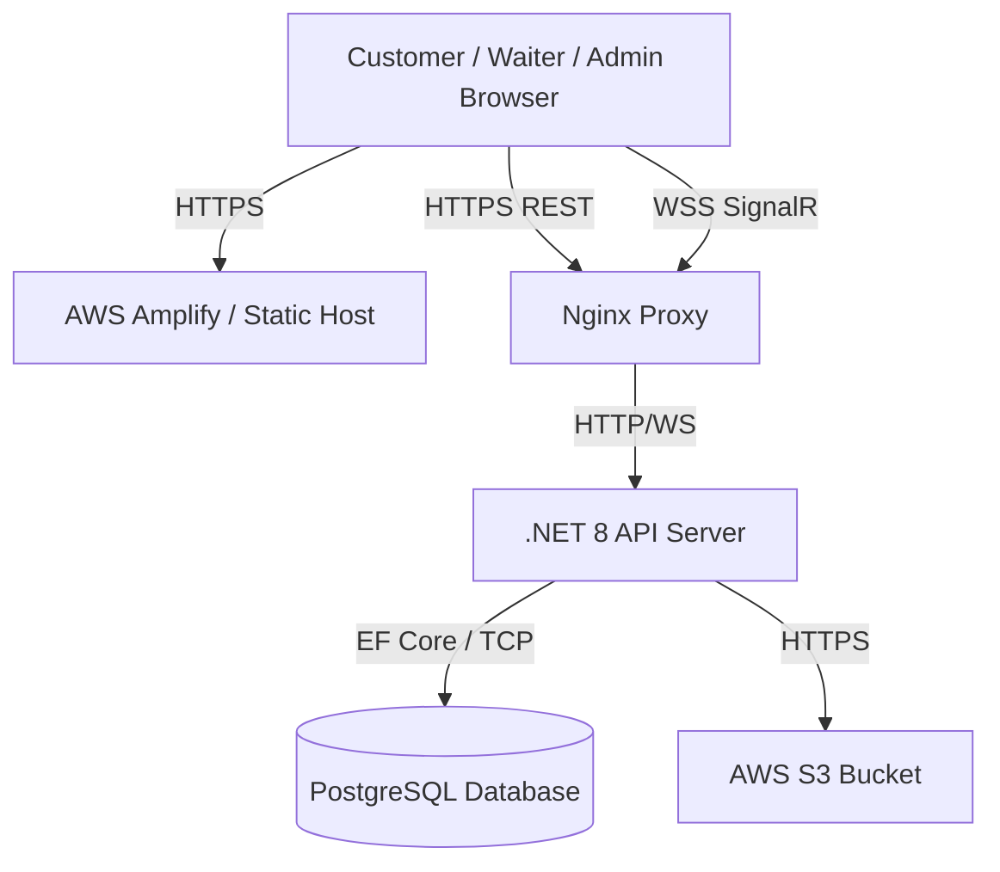
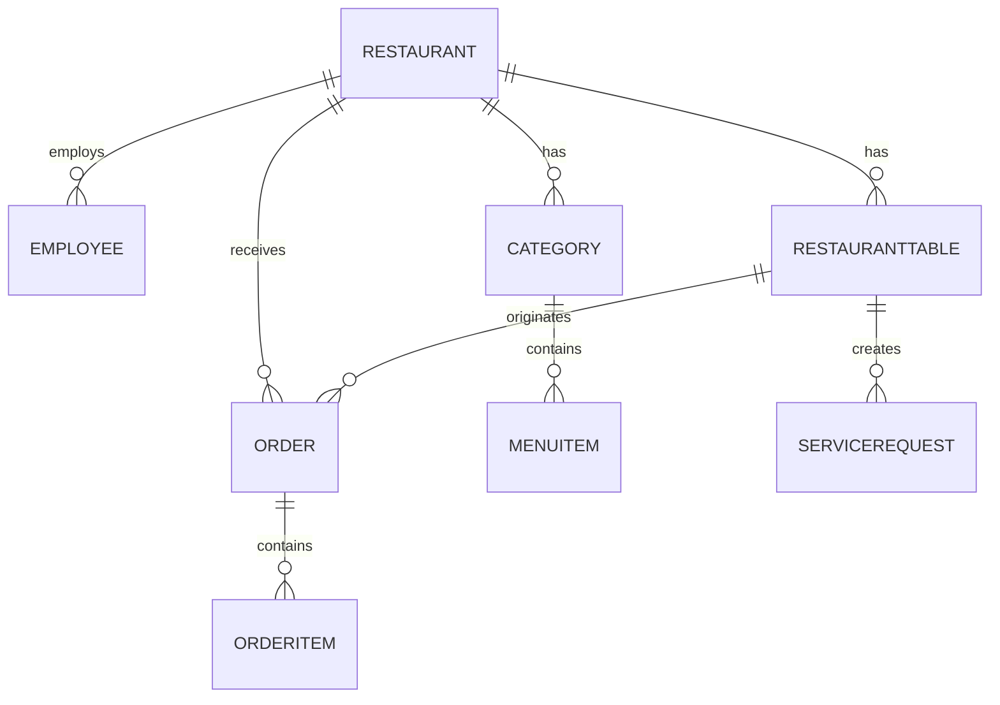
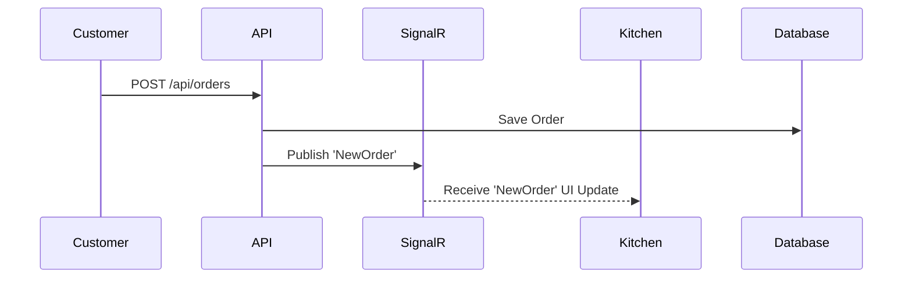
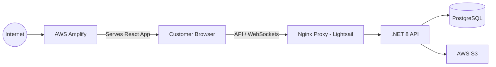

# TABLO — Project Technical Documentation

## 1. Document Purpose
This document serves as the master technical documentation for the TABLO project. It provides an accurate, verified, and comprehensive overview of the existing system architecture, infrastructure, technology stack, and implementation details.

## 2. Project Overview
TABLO is a modern restaurant QR ordering and operations platform. It streamlines the ordering process by allowing customers to scan a table-specific QR code to access a digital menu, place orders, and track order status in real-time. The system also provides a comprehensive suite of tools for restaurant staff (kitchen and waiters) and administrators to manage menus, tables, employees, and live operations.

## 3. Product Purpose
To provide a seamless, app-less digital ordering experience for restaurant patrons while empowering restaurant staff with real-time operational tools and administrators with robust management capabilities.

## 4. Core Capabilities
- **Customer Ordering:** QR code scanning, digital menu browsing, cart management, checkout, and live order tracking.
- **Kitchen Operations:** Real-time order reception and status progression (Placed → Preparing → Ready).
- **Waiter Operations:** Service requests, order delivery (Served status), and table management.
- **Restaurant Administration:** Menu, category, table, and staff (employee/role) management.
- **Platform Administration:** Multi-tenant restaurant onboarding and system administration via SuperAdmin.

## 5. Technology Stack
### Frontend
- **Framework:** React 19 / Vite (Single Page Application)
- **Language:** TypeScript
- **Routing:** TanStack Router
- **State Management/Data Fetching:** TanStack React Query
- **Styling:** Tailwind CSS v4, Radix UI, class-variance-authority, clsx, tailwind-merge
- **Icons:** Lucide React
- **Forms/Validation:** React Hook Form, Zod
- **Real-Time:** `@microsoft/signalr`

### Backend
- **Framework:** .NET 8 (ASP.NET Core Web API)
- **Language:** C#
- **ORM:** Entity Framework Core
- **Database:** PostgreSQL (Npgsql)
- **Real-Time:** SignalR

### Database
- PostgreSQL (relational database handling all application data and multi-tenant isolation).

### Infrastructure
- **Production Compute:** AWS Lightsail (Ubuntu) or similar VPS hosting the .NET API.
- **Frontend Hosting:** AWS Amplify (or standard static site hosting).
- **Reverse Proxy:** Nginx (for backend API routing).

### Storage
- **Image Storage:** AWS S3 (via `S3ImageStorageService`) with a fallback to Local Disk (`LocalImageStorageService`).

### Authentication
- JWT (JSON Web Tokens) Bearer Authentication with BCrypt password hashing.

### Real-time communication
- ASP.NET Core SignalR (WebSockets).

### Testing
- Python-based E2E scripts and integration tests located in the frontend repository (`test_*.py`, `test_*.js`).

## 6. High-Level System Architecture

## 7. Repository Structure
- `/`: Repository root containing overarching documentation and Python integration test scripts (`test_e2e.py`, `check_health.py`, etc.).
- `/Tablo.Api`: The backend .NET 8 ASP.NET Core Web API project.
  - `/Tablo.Api/Controllers`: API endpoints.
  - `/Tablo.Api/Data`: EF Core DbContext and Migrations.
  - `/Tablo.Api/Entities`: Database models.
  - `/Tablo.Api/Services`: Core business logic and integrations (S3, Email).
  - `/Tablo.Api/Repositories`: Data access layer.
  - `/Tablo.Api/Hubs`: SignalR hubs.
- `/tablo`: The frontend React/Vite project.
  - `/tablo/src/components`: UI components (shadcn/ui inspired).
  - `/tablo/src/hooks`: Custom React hooks mapping to API endpoints.
  - `/tablo/src/routes`: TanStack Router definitions.
  - `/tablo/src/services`: API client and SignalR connection managers.
- `/docs`: Documentation folder (architecture and infrastructure historical records).

## 8. Frontend Architecture
The frontend is a standard **Single Page Application (SPA)** built with React and Vite. 
*(Note: An older architecture document, `TABLE_QR_HOSTING_ARCHITECTURE_DECISION.md`, incorrectly claims this is an SSR application built for Cloudflare. Verification of `package.json` confirms it is a purely static SPA using standard Vite plugins).*

- **Framework:** React 19.
- **Build System:** Vite.
- **Routing:** TanStack Router (`@tanstack/react-router`) for type-safe routing.
- **State Management & Data Fetching:** TanStack React Query (`@tanstack/react-query`) handles all API data caching, invalidation, and background updates.
- **API Communication:** Custom Axios/Fetch wrapper (`apiClient.ts`).
- **Authentication Handling:** JWT tokens are stored locally. Interceptors or hooks inject the token into the `Authorization: Bearer` header.
- **UI Architecture:** Component-driven architecture utilizing Tailwind CSS and Radix UI primitives.
- **Environment Configuration:** Configured via `.env.*` files (e.g., `VITE_API_URL`).
- **SignalR Client:** Integrates `@microsoft/signalr` to listen for real-time order and service request events.

## 9. Backend Architecture
The backend uses a standard N-Tier architecture within a single ASP.NET Core project.

- **Structure:** `Tablo.Api` project.
- **Controllers:** Handle HTTP routing and request/response mapping.
- **Services:** Contain the core business logic (e.g., `OrderService`, `MenuService`, `TableService`).
- **Repositories:** Abstract database operations (e.g., `OrderRepository`, `MenuRepository`), injected into Services.
- **Validation:** Relies on ASP.NET Core model binding and data annotations.
- **Authentication:** Standard JWT Bearer authentication.
- **Authorization:** Role-based access control (RBAC).
- **Middleware:** CORS (`AllowFrontend`), Rate Limiting (`PublicApi` policy), Static Files (for local image storage), Authentication, Authorization.
- **Dependency Injection:** Services and Repositories are registered as Scoped in `Program.cs`.

## 10. API Architecture
- **Base Structure:** `/api/[controller]` routing.
- **Endpoint Organization:** Grouped by domain (`OrdersController`, `MenuItemsController`, `RestaurantsController`, etc.).
- **Authentication Requirements:** Endpoints are protected via `[Authorize]` attributes. Specific actions require specific roles (e.g., `[Authorize(Roles = "Kitchen")]`).
- **Request/Response Patterns:** Standard JSON payloads. Data Transfer Objects (DTOs) are used to prevent over-posting and hide internal entity structures.
- **Frontend-to-API:** The frontend calls these endpoints natively and parses the JSON responses.

## 11. Database Architecture
- **Engine:** PostgreSQL.
- **ORM:** Entity Framework Core.
- **DbContext:** `ApplicationDbContext`.
- **Entities:**
  - `Restaurant`, `RestaurantSettings`, `RestaurantOrderSequence`
  - `Employee`, `Role`
  - `Category`, `MenuItem`
  - `RestaurantTable`
  - `Order`, `OrderItem`
  - `ServiceRequest`
- **Tenant Isolation:** A strict multi-tenancy model where nearly all operational entities (`Order`, `Employee`, `MenuItem`, `RestaurantTable`) contain a `RestaurantId` foreign key.
- **Migration Architecture:** Code-first migrations are located in the `/Migrations` folder. Migrations are executed explicitly via `dotnet ef database update` using an `IDesignTimeDbContextFactory`.

## 12. Authentication & Authorization
- **Login:** `AuthController` handles credential verification and issues JWTs.
- **JWT:** Contains `sub` (UserId), `email`, `role`, and `restaurantId` (if applicable) as claims.
- **Roles:** SuperAdmin, RestaurantAdmin, Kitchen, Waiter.
- **Authorization Policies:** Enforced via ASP.NET Core `[Authorize(Roles = "...")]`.
- **Password Handling:** Passwords are hashed using BCrypt.
- **Admin Authentication:** The initial SuperAdmin configuration is loaded from `appsettings.json` or Environment Variables (as verified in `Program.cs`).

## 13. Multi-Tenancy Architecture
- **Tenant Identification:** Each restaurant is a separate tenant identified by `RestaurantId`.
- **Data Isolation:** Enforced at the Repository/Service layer. Employees associated with `Restaurant A` cannot query or mutate data belonging to `Restaurant B`.
- **Request Association:** The `RestaurantId` claim in the staff's JWT automatically binds their API operations to their respective restaurant. For customers, the `RestaurantId` is inferred from the scanned Table QR token.

## 14. Restaurant Administration
The platform supports multi-tenant administration:
- **SuperAdmin:** Can create new `Restaurant` tenants and assign initial `RestaurantAdmin` users.
- **RestaurantAdmin:** Can manage their specific restaurant's menu, tables, settings, and staff (Kitchen/Waiter roles).

## 15. Menu Architecture
- **Categories:** Logical groupings (e.g., "Starters", "Mains").
- **Menu Items:** Linked to a Category. Contain pricing, descriptions, and availability flags.
- **Image Handling:** Items can have images. The API accepts image uploads, routes them through `IImageStorageService` (to S3 or Local), and saves the resulting URL to the database.

## 16. Table & QR Architecture
- **Table Creation:** Admins create physical tables mapping to the restaurant floorplan.
- **QR Generation:** The system generates a secure, unique QR token for each table.
- **Customer Identity:** When a customer scans the QR code, the frontend identifies the `RestaurantId` and `TableId` without requiring user registration.

## 17. Customer Ordering Architecture
**Flow:**
1. Customer scans Table QR.
2. Frontend loads the specific Restaurant's menu.
3. Customer adds `MenuItems` to the Cart.
4. Customer proceeds to Checkout.
5. Frontend POSTs the cart payload to the API.
6. API validates the payload, verifies table identity, creates an `Order` and `OrderItems`, and publishes a SignalR event to the Kitchen.

## 18. Order Architecture
- **Order Entity:** Tracks `TableId`, `RestaurantId`, `TotalAmount`, `Status`, `PaymentStatus`.
- **Order Items:** Snapshots of the menu item (Price, Name) at the time of order creation.
- **Order Lifecycle States:** Placed → Preparing → Ready → Served.
- **Transactional Behavior:** Orders and OrderItems are created within a single EF Core transaction to ensure consistency.

## 19. Kitchen Architecture
- **Workflow:** Kitchen staff monitor a real-time dashboard powered by SignalR.
- **Actions:** As orders arrive, staff update the status from `Placed` to `Preparing`, and then to `Ready`. These updates trigger SignalR broadcasts to notify customers and waiters.

## 20. Waiter Architecture
- **Workflow:** Waiters receive real-time notifications for `Ready` orders and `Service Requests` (e.g., "Call Waiter", "Bill Please").
- **Actions:** Waiters deliver food and update the order status to `Served`. They also clear resolved Service Requests.

## 21. Billing Architecture
- **Implementation:** Billing is currently handled natively by aggregating order totals per table. Service requests for "Bill Please" alert the waiter to finalize the table's tab.

## 22. Payment Architecture
- **Implementation:** The codebase currently handles order state and total calculation.

> [!WARNING]
> No active external digital payment provider such as Stripe or PayPal has been verified in the current core transaction flow. Payment status/settlement must NOT be interpreted as an active online payment gateway integration. Billing is handled natively via physical waitstaff collection.

## 23. SignalR / Real-Time Architecture
- **Hub:** `OrderHub` located at `/hubs/order`.
- **Authentication:** `Program.cs` extracts the `access_token` from the query string to authenticate WebSocket connections.
- **Event Flow:** When an Order is updated or a Service Request is created, the API calls the Hub context to push messages to connected clients (filtered by `RestaurantId` groups).

## 24. Image Storage Architecture
- **Abstraction:** `IImageStorageService` interface.
- **Implementations:** 
  - `S3ImageStorageService`: Uploads directly to an AWS S3 Bucket.
  - `LocalImageStorageService`: Saves files to the `wwwroot/images` folder.
- **Configuration:** Controlled by the `ImageStorage:Provider` key in `appsettings.json`.
- **Production Behavior:** Must use S3 (`ImageStorage:Provider=S3`) to ensure the API instances remain stateless.

## 25. AWS Infrastructure
The current production infrastructure utilizes AWS Lightsail and AWS Amplify.

## 26. Production Architecture
- **Frontend Hosting:** AWS Amplify. It builds and serves the static Vite output globally.
- **API Hosting:** AWS Lightsail (Ubuntu VM).
- **Reverse Proxy:** Nginx routes external port 443/80 traffic to the internal Kestrel port.
- **Database Hosting:** External Managed PostgreSQL or isolated Lightsail Database.
- **Storage:** AWS S3 for all user-generated media.

## 27. Environment Configuration
Important environment variables used in production (Secrets omitted):
- `ConnectionStrings__DefaultConnection`
- `Jwt__Key`, `Jwt__Issuer`, `Jwt__Audience`
- `AllowedOrigins__0`, `AllowedOrigins__1`
- `ImageStorage__Provider`
- `ImageStorage__S3__BucketName`, `ImageStorage__S3__Region`
- `SuperAdmin__Username`, `SuperAdmin__Password`

## 28. Database Migration Strategy
- **Framework:** EF Core.
- **Process:** Migrations are NOT applied automatically on application startup.
- **Production Execution:** Migrations are applied out-of-band using `dotnet ef database update` pointing to the production database via environment variables prior to scaling new API instances.

## 29. Testing Architecture
- **Testing Approach:** Python-based End-to-End (E2E) and integration scripts located in the root repository (`test_e2e.py`, `test_order.py`, etc.).
- **Execution:** These scripts simulate frontend network requests and WebSocket connections to validate entire vertical flows (Auth → Order → SignalR Event).

## 30. Security Architecture
- **Authentication:** Strict JWT Bearer token enforcement.
- **Tenant Isolation:** enforced via query and command boundaries in the Services layer.
- **Secret Handling:** Removed from Git tracking. Secrets injected via environment variables.
- **S3 Security:** Backend authenticates with AWS IAM to write/delete; S3 objects are publicly readable.
- **CORS:** Restricts API access to explicitly whitelisted `AllowedOrigins`.

## 31. Git & Branch Strategy
- **Branches:** `dev` (integration), `production` (stable release), and feature branches.
- **Workflow:** Features are developed, merged into `dev` for testing, and eventually fast-forwarded or merged into `production` to trigger deployments.

## 32. Deployment Architecture
- **Frontend:** Automatically triggers via AWS Amplify when the `production` branch is updated.
- **Backend:** Deployed via pull/rebuild on the Lightsail instance and managed via systemd/Nginx.

## 33. Production Resources
- **Frontend Host:** AWS Amplify.
- **Backend Compute:** AWS Lightsail Ubuntu Instance.
- **Proxy:** Nginx.
- **Storage:** AWS S3 (Bucket).

## 34. Production Endpoints
- **Base URL:** Inherited from the Nginx proxy mapping.
- **API Path:** `/api/[Controller]`
- **SignalR Path:** `/hubs/order`

## 35. Current Production State
- **Verified:** Fully operational multi-tenant order flow, SignalR real-time notifications, JWT authentication, and S3 image integration.
- **Verified Discrepancy:** The `TABLE_QR_HOSTING_ARCHITECTURE_DECISION.md` document historically designated the frontend as an SSR Cloudflare deployment. The *actual* verified repository state is a standard Vite SPA hosted via AWS Amplify.

## 36. Known Limitations
- Waiters must be actively connected to receive SignalR events; there is currently no verified push notification (APNS/FCM) implementation for offline devices.
- SuperAdmin configuration currently relies on environment variable injection on startup rather than a database-driven UI flow for initial bootstrap.

## 37. Deferred Improvements
- Integration of a formal payment gateway (e.g., Stripe) for digital checkout.
- Automated push notifications for staff.
- Comprehensive UI for SuperAdmin environment configuration management.

## 38. Technical Glossary
- **SuperAdmin:** The master platform administrator.
- **RestaurantAdmin:** A manager of a specific tenant.
- **QR Token:** A cryptographically secure or universally unique identifier bound to a physical table to allow unauthenticated customer ordering.
- **Tenant:** A distinct restaurant operating on the shared Tablo platform.
