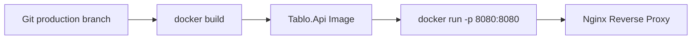
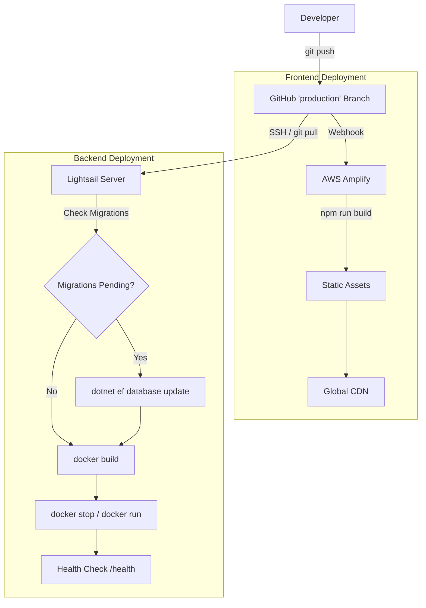
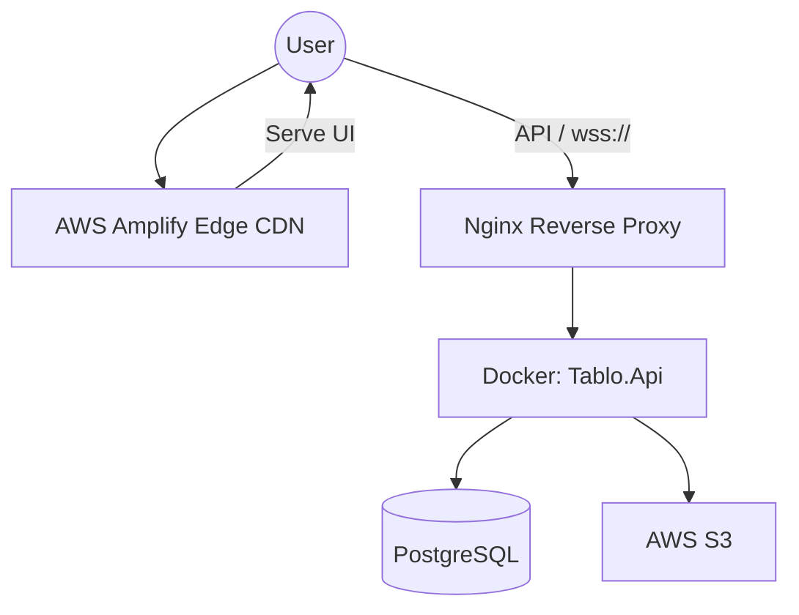

# TABLO — Project Deployment Documentation

## 1. Document Purpose
This document provides authoritative, comprehensive instructions and architectural definitions for the current TABLO production deployment. It acts as the single source of truth for how TABLO code moves from the repository into a live production environment, overriding any historical deployment documentation.

## 2. Deployment Philosophy
The TABLO deployment model prioritizes strict separation of concerns, multi-tenant safety, and zero-downtime stateless API hosting.
- **Frontend Decoupling:** The frontend is a static SPA served from the edge via AWS Amplify, physically detached from the backend compute.
- **Stateless Backend:** The API instances process requests and stream events via SignalR but store no persistent file data locally. Menu images map to S3, and application state maps to PostgreSQL.
- **Explicit Migrations:** EF Core migrations are never executed automatically at startup to prevent race conditions during scaling. They are explicitly verified and applied out-of-band.

## 3. Current Production Architecture
*(Verified against the actual repository configuration)*

```mermaid
graph TD
    Internet((Internet)) -->|HTTPS| Amp[AWS Amplify Edge]
    Amp -->|Static Assets| Browser[Customer Browser]
    Browser -->|HTTPS API / wss:// SignalR| Nginx[Nginx Proxy]
    
    subgraph AWS Lightsail VM (Ubuntu)
        Nginx -->|HTTP 8080| Docker[Docker Container]
        Docker -->|.NET 8 Kestrel| API[ASP.NET Core API]
    end
    
    API -->|TCP 5432| DB[(Managed PostgreSQL)]
    API -->|HTTPS| S3[AWS S3 Bucket]
```

## 4. Production Components
- **Frontend:** React 19 / Vite Single Page Application (SPA).
- **API:** .NET 8 ASP.NET Core Web API.
- **Docker:** Hosts the compiled API binary.
- **Nginx:** Functions as a reverse proxy, SSL termination layer, and WebSocket upgrader.
- **PostgreSQL:** Primary relational database and tenant isolation boundary.
- **S3:** AWS S3 Bucket for permanent, highly available menu image storage.
- **SignalR:** Integrated directly into the ASP.NET Core API for real-time order tracking.
- **DNS/HTTPS:** Managed by AWS Amplify (for frontend) and Lightsail/Let's Encrypt (for backend).

## 5. AWS Region and Resources
*(Safe architectural references only)*
- **Frontend Hosting:** AWS Amplify App.
- **Compute:** AWS Lightsail Linux instance.
- **Storage:** Private AWS S3 bucket with IAM programmatic access configured for the API.
- **Database:** PostgreSQL.

## 6. Repository and Branch Strategy
- **`dev` (Development):** The primary integration branch. Pull requests are merged here.
- **`production` (Production):** The stable release branch. Commits pushed here trigger the AWS Amplify automated build pipeline for the frontend and denote code that is ready to be pulled to the Lightsail instance.

## 7. Deployment Prerequisites
Before initiating a deployment, the following must exist:
- **Git Access:** Permissions to pull the `production` branch.
- **AWS Access:** Access to the Amplify Console.
- **SSH Access:** SSH keys for connecting to the Lightsail Ubuntu instance.
- **Production Configuration:** Secure environment variables (e.g., PostgreSQL credentials, JWT Key, S3 access keys) must already be securely configured on the Lightsail server.

## 8. Frontend Deployment
The frontend is a pure static Single Page Application. It does NOT use Server-Side Rendering (SSR) or Cloudflare Workers.
- **Build Engine:** Vite (`npm run build`).
- **Production Environment Variable:** `VITE_API_URL` must point to the production Nginx domain (e.g., `https://api.yourdomain.com/api`).
- **Build Output:** The generated static assets reside in `tablo/dist`.
- **SPA Rewrite:** Because it is an SPA (using TanStack Router), the server must rewrite all 404 navigation requests back to `index.html`. This is accomplished via the `amplify-rules.json` configuration.

## 9. AWS Amplify Configuration
The frontend automatically deploys via AWS Amplify using the `amplify.yml` file located in the repository root.
- **Application Root:** `tablo/`
- **Branch Trigger:** `production`
- **Build Command:** `npm ci` followed by `npm run build`.
- **Artifacts:** `dist/**/*`
- **SPA Routing:** Configured via `amplify-rules.json` to enforce `{"source": "/<*>", "target": "/index.html", "status": "404-200"}`.
- **Environment Variables:** Set securely in the Amplify Console.

## 10. Backend Deployment



## 11. Docker Deployment
- **Dockerfile:** Multi-stage build located at `Tablo.Api/Dockerfile`.
- **Runtime Image:** `mcr.microsoft.com/dotnet/aspnet:8.0`.
- **Exposed Port:** The container exposes port `8080`.
- **Environment Configuration:** Handled entirely via environment variables passed securely at runtime (e.g., `--env-file /secure/path/api.env`).
- **Volume Requirements:** Because the application is configured for `S3` image storage, no persistent Docker volumes are required. The container is stateless.

## 12. Lightsail API Server
- **Server Role:** Production API host.
- **Operating System:** Ubuntu Linux.
- **Docker:** Runs the `.NET` API.
- **Nginx:** Installed on the host OS to route traffic to Docker.
- **Firewall:** Only ports `80` (HTTP), `443` (HTTPS), and `22` (SSH for admins) are exposed to the public internet.

## 13. Nginx Configuration
The current `nginx-default.conf` configures the host to proxy requests cleanly to Kestrel:
- **Reverse Proxy:** Forwards `/` to `http://127.0.0.1:8080`.
- **WebSocket/SignalR Support:** Explicitly defines the `/hubs/order` block to upgrade HTTP connections to WebSockets:
  ```nginx
  proxy_set_header Upgrade $http_upgrade;
  proxy_set_header Connection "Upgrade";
  ```
- **Forwarded Headers:** Injects `X-Forwarded-For` and `X-Forwarded-Proto` so the .NET app understands the original client IP and HTTPS scheme.

## 14. HTTPS / TLS
- **Frontend HTTPS:** Automatically managed and provisioned natively by AWS Amplify.
- **Production API HTTPS:** TLS termination occurs at the Nginx layer on the Lightsail instance (typically via Let's Encrypt / Certbot). The Docker container itself operates in HTTP mode (`http://0.0.0.0:8080`).

## 15. API Domain
The production API endpoint corresponds to the domain pointed to the Lightsail instance. The frontend accesses it via the URL injected at build time via `VITE_API_URL`.

## 16. Production Environment Configuration
The backend requires the following configuration categories set securely in the OS/Docker environment:
- **Database:** `ConnectionStrings__DefaultConnection`
- **JWT:** `Jwt__Key`, `Jwt__Issuer`, `Jwt__Audience`
- **S3:** `ImageStorage__Provider` (must be `S3`), `ImageStorage__S3__BucketName`, `ImageStorage__S3__Region`. AWS IAM keys are typically provided securely via the host environment.
- **CORS:** `AllowedOrigins__0` (must explicitly whitelist the Amplify frontend URL).
- **Initialization:** `SuperAdmin__Username`, `SuperAdmin__Password`
- **Seed Data:** `SeedDummyData=false`

## 17. PostgreSQL Deployment
- **Architecture:** Managed Relational Database Service.
- **Private Access:** Should not be exposed to the public internet; accessible only from the Lightsail API IP.
- **Backup:** Automated daily snapshots configured on the managed database service.

## 18. Database Migration Deployment
*(Sourced from `docs/infrastructure/TABLE_QR_MIGRATION_PROCEDURE.md`)*
Migrations are **NOT** applied automatically at startup.
- **When Required:** Anytime a pull request alters the EF Core `Entities/` and generates a new migration in `Tablo.Api/Migrations`.
- **Application:** Executed out-of-band via the `.NET EF CLI` (`dotnet ef database update`) on a secure administration machine or CI environment.
- **Production Safety:** The `ConnectionStrings__DefaultConnection` environment variable must be temporarily set in the terminal targeting the production database.
- **Verification:** Connect to PostgreSQL and query `__EFMigrationsHistory` to verify the latest migration ID.

## 19. S3 Deployment
- **Purpose:** Stateless storage for Restaurant Menu Items.
- **Public Access:** The bucket itself allows public read access for the images.
- **IAM Access Model:** The backend API utilizes an IAM User/Role with restricted `s3:PutObject`, `s3:DeleteObject` permissions to manipulate images.

## 20. CORS
CORS is strictly enforced by the ASP.NET Core middleware. The `AllowedOrigins` configuration array must exactly match the `https://` production URL assigned by AWS Amplify. Wildcards (`*`) are disallowed for SignalR credential compatibility.

## 21. SignalR Deployment
- **Endpoint:** `/hubs/order`
- **Nginx Requirements:** Nginx must explicitly support `Connection: Upgrade` (verified present).
- **Authentication:** `Program.cs` intercepts `access_token` query parameters to attach the JWT identity to the WebSocket handshake.

## 22. Complete Deployment Sequence



## 23. Pre-Deployment Checklist
- [ ] Code is merged to the `production` branch.
- [ ] No secrets are hardcoded in the codebase.
- [ ] EF Core migrations have been reviewed.
- [ ] Database backup is verified.
- [ ] `VITE_API_URL` and `AllowedOrigins` match.

## 24. Backend Deployment Procedure
*Currently, backend deployment is semi-automated/manual.*
1. SSH into the Lightsail instance.
2. Navigate to the repository directory.
3. Pull the latest code: `git checkout production && git pull origin production`.
4. Build the new Docker image: `docker build -t tablo-api ./Tablo.Api`.
5. Stop and remove the old container.
6. Run the new container: `docker run -d --name tablo-api -p 8080:8080 --env-file /secure/path/api.env tablo-api`.

## 25. Frontend Deployment Procedure
Fully automated. Pushing to the `production` branch on GitHub automatically triggers an AWS Amplify deployment pipeline. Progress can be monitored in the Amplify Console.

## 26. Database Deployment Procedure
Handled safely out-of-band:
1. Export the secure connection string variable.
2. Run `dotnet ef database update` inside the `Tablo.Api` directory.
3. Verify `__EFMigrationsHistory`.

## 27. Post-Deployment Verification
Verify the following vertical slices:
1. **Frontend Availability:** Load the Amplify URL in an incognito window.
2. **API Health:** Check `https://api.domain.com/health` returns `200 OK`.
3. **Authentication:** Log in to the SuperAdmin dashboard.
4. **Order Creation:** Add an item to the cart and checkout.
5. **SignalR:** Verify the order appears instantly on the Kitchen dashboard without a page refresh.
6. **S3:** Upload a test menu item image and verify it renders successfully.

## 28. Production Health Checks
The API exposes a verified health endpoint at `/health`. It internally tests `context.Database.CanConnectAsync()` and returns `200 OK` ("Healthy") or `503 Service Unavailable` ("Unhealthy").

## 29. Production Logs
- **Docker/API:** Executable via `docker logs tablo-api` on the Lightsail VM.
- **Nginx:** Located at `/var/log/nginx/error.log` and `access.log`.
- **Amplify:** Build and runtime logs are available in the AWS Amplify Console.

## 30. Rollback Strategy
- **Frontend:** AWS Amplify supports instant 1-click rollback to a previously successful build.
- **Backend:** Re-tag and run the previous Docker image ID. E.g., `docker run -d tablo-api:previous-tag`.
- **Configuration:** Revert the `.env` file on the server and restart the container.

## 31. Database Rollback Considerations
**Never roll back backend code if it requires a newer database schema.** EF Core downgrades (`dotnet ef database update <PreviousMigration>`) are highly destructive (they drop tables/columns). Always restore the PostgreSQL database from the daily snapshot before rolling back the API container if schema changes were involved.

## 32. Emergency Recovery
If the server fails completely:
1. Provision a new Lightsail Ubuntu instance.
2. Install Docker and Nginx.
3. Clone the repository and configure the Nginx `.conf`.
4. Restore `api.env` from your secure password manager.
5. Build and run the Docker container.
6. Update DNS A-records.

## 33. Troubleshooting
- **Frontend Unavailable:** Check AWS Amplify build logs; verify SPA routing rules are correct.
- **502 Bad Gateway from Nginx:** The Docker container is crashed or offline. Check `docker logs tablo-api`.
- **Database Connectivity:** Check the `DefaultConnection` string. Ensure the DB firewall allows the Lightsail IP.
- **S3 Image Failure:** Ensure `ImageStorage:Provider` is set to `S3` and IAM credentials are correct.
- **CORS Failure:** Verify `AllowedOrigins` includes the exact Amplify URL without trailing slashes.
- **SignalR Failure:** Verify Nginx `Upgrade` headers are present and the frontend `VITE_API_URL` is using `HTTPS`.

## 34. Production Safety Rules
- **No Direct DB Modification:** Never manually alter tables in production; always use EF Core migrations.
- **No Secret Commits:** Never track `appsettings.json` or `.env` files.
- **Preserve Flow:** Ensure the stateless nature of the API is maintained by preventing Local image storage in production.

## 35. Current Production State
The current verified state is a highly robust decoupled architecture. The frontend is fully separated via AWS Amplify. The backend is containerized and stateless, utilizing S3 and managed PostgreSQL.
**Note:** Older documentation heavily implied a Cloudflare/Nitro SSR deployment. *This has been formally audited and removed. The current Amplify SPA deployment is the factual reality.*

## 36. Known Deployment Limitations
- **Manual Backend Deployment:** The Lightsail Docker deployment currently requires manual SSH access to pull and rebuild. There is no automated GitHub Action CI/CD pipeline triggering the server update.

## 37. Deferred Deployment Improvements
- Implementing a full GitHub Actions workflow to build the Docker image, push it to an Elastic Container Registry (ECR), and remotely trigger a Lightsail container update.

## 38. Deployment Verification Checklist
- [ ] Amplify Build Succeeded
- [ ] Migrations Applied Successfully
- [ ] Docker Container Running
- [ ] `/health` returns 200 OK
- [ ] Frontend CORS preflight succeeds
- [ ] SignalR WebSockets connect without error

## 39. Deployment Architecture Diagram



## 40. Alternative Frontend Hosting: Vercel Deployment
For deploying the frontend on Vercel as a Vite Single Page Application, refer to the dedicated guide:
- See [VERCEL_DEPLOYMENT_GUIDE.md](VERCEL_DEPLOYMENT_GUIDE.md) for full configuration, `vercel.json` rewrites, and post-deployment CORS setup.

## 41. Quick Deployment Reference
**Frontend:** Push to `production` branch on GitHub.
**Backend:**
```bash
ssh ubuntu@live-server
cd /opt/tablo
git pull origin production
docker build -t tablo-api ./Tablo.Api
docker stop tablo-api && docker rm tablo-api
docker run -d --name tablo-api -p 8080:8080 --env-file .env tablo-api
```
