# TABLO — Complete Project Flow Documentation

## 1. Purpose
This document provides a comprehensive, verified explanation of how the TABLO system works functionally and technically. It maps the complete lifecycle of operations from initial restaurant setup to customer ordering, kitchen fulfillment, and waiter service. The flows described here are strictly based on the current repository implementation.

## 2. Complete System Flow

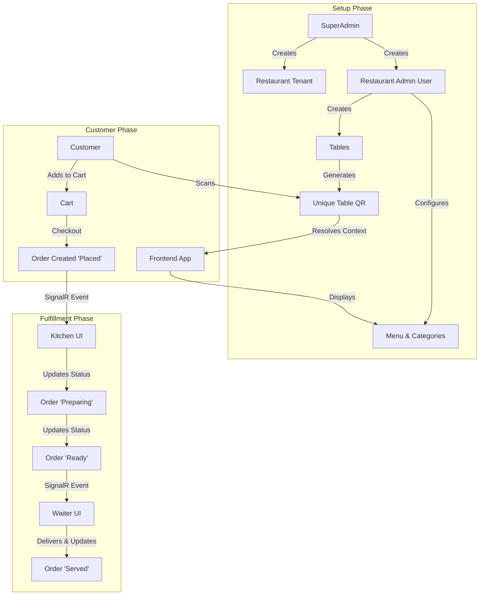

## 3. User Roles
The following roles are actively implemented and enforced via JWT Claims:
- **SuperAdmin:** Has system-wide access. Can create new Restaurants (Tenants) and assign initial RestaurantAdmins.
- **Restaurant Admin (`Admin`):** Manages a specific restaurant's menu, tables, settings, and staff (Kitchen/Waiter).
- **Kitchen (`Kitchen`):** Views the live order board. Progresses orders from `Placed` → `Preparing` → `Ready`.
- **Waiter (`Waiter`):** Views `Ready` orders for delivery (`Served`). Receives and completes Table Service Requests.
- **Customer (Anonymous):** Unauthenticated users bounded to a specific table context via a QR Token. Can place orders and create service requests.

## 4. SuperAdmin Flow
The SuperAdmin manages system multi-tenancy. Initial SuperAdmin credentials are mathematically injected via server environment variables (`appsettings.json`), bypassing the database for bootstrap security.

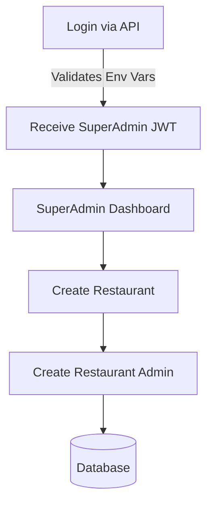

## 5. Restaurant Admin Flow
The Restaurant Admin manages the operational data of their specific tenant.
**Flow:**
1. Login via `/api/auth/login`.
2. Receives JWT containing their `RestaurantId` claim.
3. Accesses Admin Dashboard.
4. Manages Employees (`/api/employees`).
5. Manages Categories and Menu Items (`/api/restaurants/{id}/menu-items`).
6. Manages Tables and QRs (`/api/restaurants/{id}/tables`).

## 6. Restaurant Setup Flow

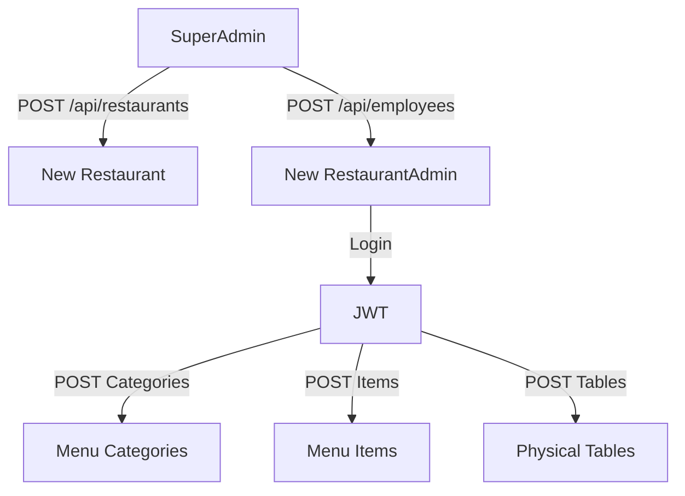

## 7. Menu Management Flow
- **Category:** Created first. Acts as a container for Menu Items.
- **Menu Item:** Created within a Category. Includes properties like `Price`, `IsAvailable`, and `ImageUrl`.
- **Image Upload:** When an Admin creates an item with an image, the frontend sends multipart form data to `/api/restaurants/{id}/menu-items`. The API validates the file extension and streams the file to `IImageStorageService` (e.g., S3), which returns the public URL saved to the database.

## 8. Table Management Flow
- **Create Table:** Admin specifies a `TableNumber` and `Capacity`.
- **QR Generation:** The backend automatically generates a cryptographically random `QRToken` for the table.
- **Download:** The Admin can trigger `/api/restaurants/{id}/tables/{id}/qr`, which invokes the `QRCoder` library to generate a physical `.png` image encoding the URL `origin/t/{QRToken}`.

## 9. QR Flow
When a customer scans a table QR code:

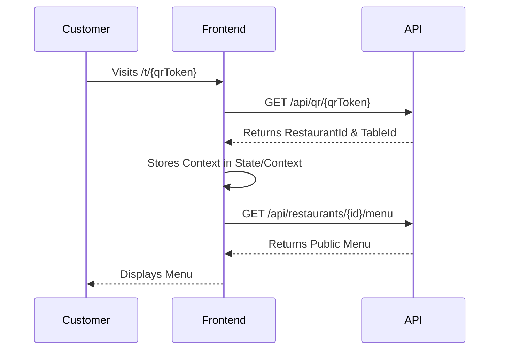

## 10. Customer Menu Flow
1. The frontend resolves the QR token to establish the `RestaurantId` and `TableId` context.
2. The customer views categories and available items.
3. Clicking an item opens details.
4. The item is added to the local frontend cart state.

## 11. Cart Flow
- **Frontend Only:** Cart state is entirely managed on the frontend via React state/hooks.
- **Calculations:** Subtotals are calculated dynamically based on quantity × unit price.
- **Action:** Clicking "Checkout" transitions to the checkout confirmation screen.

## 12. Checkout Flow
- **Order Summary:** Customer reviews items.
- **Table Context:** The payload attaches the session's `RestaurantId` and `TableId`.
- **Payment Selection:** (No external payment processor is active). The system records the financial totals (Subtotal, Tax, TotalAmount) to be settled natively.
- **Submission:** The frontend sends a `POST /api/orders` request with the `CreateOrderRequestDto`.

## 13. Order Creation Flow

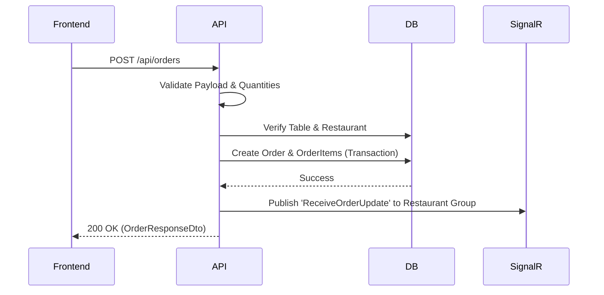

## 14. Order Lifecycle
The actual verified states in the system:
1. **Placed:** Initial state upon customer checkout.
2. **Preparing:** Kitchen has acknowledged and started cooking.
3. **Ready:** Kitchen has finished; awaiting Waiter pickup.
4. **Served:** Waiter has delivered to the table.
5. **cancelled:** Order manually voided.
6. **rejected:** Order declined by the kitchen.

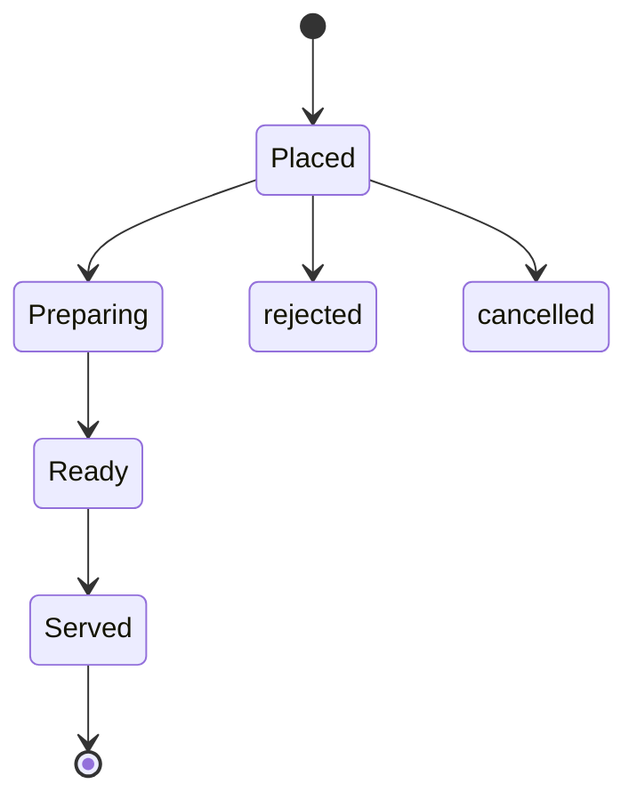

## 15. Kitchen Flow
1. Kitchen staff log in and connect to the SignalR Hub.
2. The UI listens for `ReceiveOrderUpdate`.
3. New orders (`Placed`) appear on the kitchen board.
4. Kitchen staff click "Start" → `PATCH /{orderId}/status` with status `Preparing`.
5. Kitchen staff click "Done" → status `Ready`.
6. Each status change triggers a SignalR broadcast.

## 16. Waiter Flow
1. Waiters log in and connect to SignalR.
2. They monitor `Ready` orders. Once delivered, they update the status to `Served`.
3. **Service Requests:** Customers can tap "Call Waiter" or "Bill Please".
   - Frontend `POST /api/servicerequests/qr/{qrToken}`.
   - Waiter receives SignalR event.
   - Waiter `PATCH /api/servicerequests/{id}/acknowledge`.
   - Waiter `PATCH /api/servicerequests/{id}/complete`.

## 17. Billing Flow
- **Trigger:** Waiter receives a "Bill Please" Service Request or checks the table manually.
- **Aggregation:** Orders associated with the `TableId` that are not `cancelled`/`rejected` constitute the bill. The system tracks `TotalAmount`, `Tax`, and `Discount`.
- **Completion:** Payment is settled natively (cash/card at table) by the waiter marking the transaction as complete (or the system clearing the table).

## 18. Payment Flow
**CRITICAL LIMITATION:** There is **no verified external payment provider integration** (e.g., Stripe, PayPal, Razorpay) implemented in the backend API's order creation flow. The current system models `TotalAmount` and `PaymentStatus`, but processing is handled manually (cash/card terminal) by the waiter on the floor. 

## 19. SignalR Flow

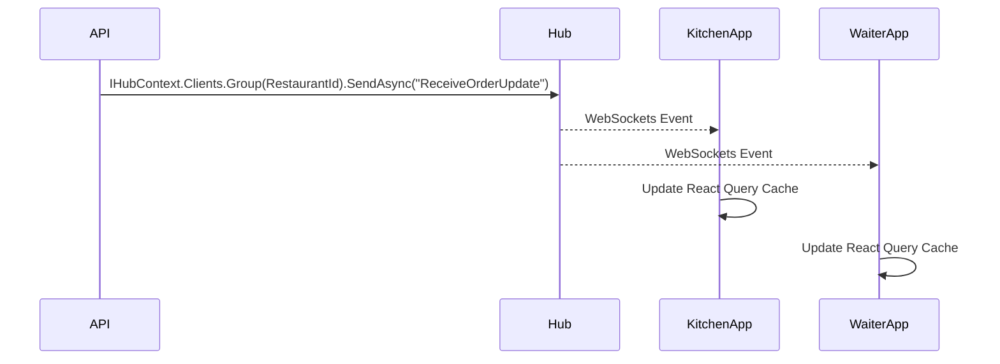
- **Authentication:** `access_token` is passed via query string for WebSockets and verified in `Program.cs`.

## 20. Image Upload Flow
- **Frontend:** Admin selects file in React form.
- **API:** Sent as `multipart/form-data` to API.
- **Storage Abstraction:**
  - If `ImageStorage:Provider == S3`: Sent directly to AWS S3 Bucket.
  - If `Local`: Saved to `wwwroot/images` (useful for local development).
- **Result:** API returns the absolute HTTP URL of the image, which is saved to the `MenuItem` database record.

## 21. Authentication Flow

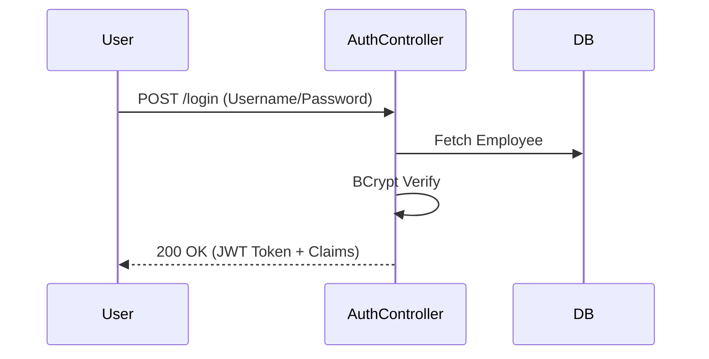

## 22. Authorization Flow
1. Client sends `Authorization: Bearer <JWT>`.
2. ASP.NET Core Middleware extracts claims (`Role`, `RestaurantId`, `sub`).
3. Endpoint attribute `[Authorize(Roles = "Admin")]` rejects unauthorized requests with `403 Forbidden`.
4. Controller logic explicitly validates the `RestaurantId` claim against the resource being accessed to prevent cross-tenant IDOR.

## 23. Multi-Tenant Flow
This is the most critical security boundary in TABLO.

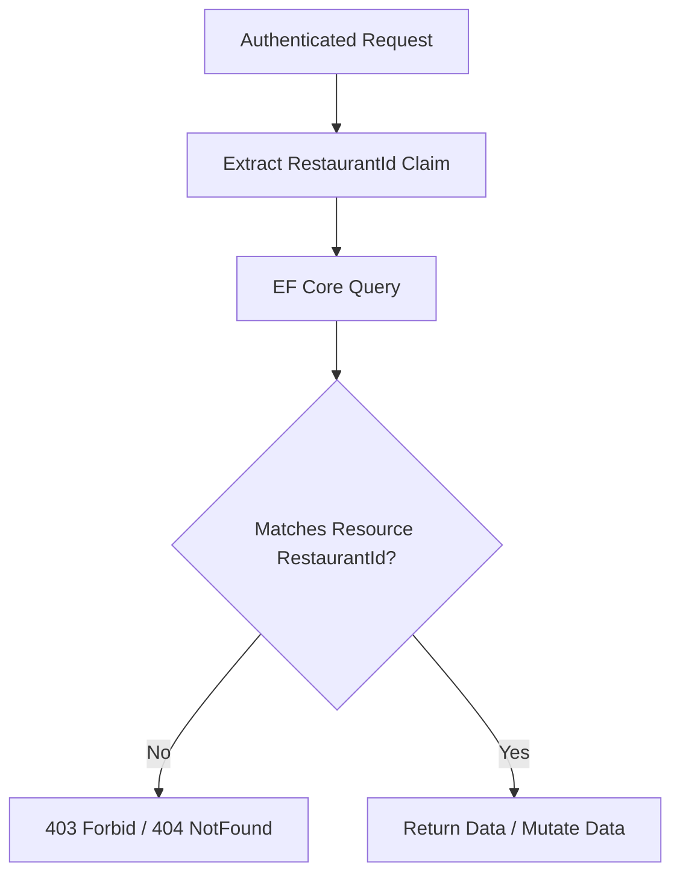
Almost every operational controller begins with: `if (User.GetRestaurantId() != request.RestaurantId) return Forbid();`

## 24. Frontend → API Flow
**Example (Fetch Orders):**
1. **React Component:** `<OrderBoard />` mounts.
2. **Hook:** `useOrders(restaurantId)` is called.
3. **API Client:** React Query calls `apiClient.get('/restaurants/{id}/orders')`.
4. **HTTP Request:** Network call with JWT Bearer token.
5. **ASP.NET Controller:** `OrdersController.GetOrders()`.
6. **Service:** `OrderService.GetOrdersAsync()`.
7. **EF Core:** Queries `ApplicationDbContext`.
8. **PostgreSQL:** Executes `SELECT ... WHERE RestaurantId = @id`.
9. **Response:** JSON serialized `List<OrderDto>`.
10. **React State:** React Query caches the data and Triggers UI re-render.

## 25. API → Database Flow
- **Authentication:** `Employee` table lookup by Username.
- **Menu:** `Category` and `MenuItem` queries filtered by `RestaurantId`.
- **Tables:** `RestaurantTable` queries filtered by `RestaurantId`.
- **Orders:** Complex inserts across `Order` and `OrderItem` tables executed within an EF Core SaveChanges transaction.

## 26. API → S3 Flow
Upload flow: `IImageStorageService.UploadImageAsync` → Creates `PutObjectRequest` → Uploads stream to AWS S3 → Returns `https://{bucket}.s3.{region}.amazonaws.com/{filename}`.

## 27. Production Request Flow

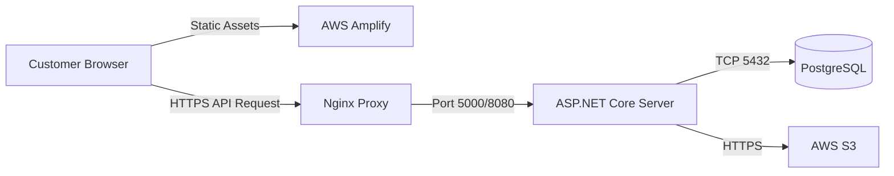

## 28. Error Flow
- **Authentication Failure:** `401 Unauthorized` (Invalid JWT or failed login).
- **Authorization/Tenant Mismatch:** `403 Forbidden` (User attempted to access another restaurant's data).
- **Validation Failure:** `400 BadRequest` (Invalid DTOs, negative prices, missing required fields).
- **Not Found:** `404 NotFound` (Invalid QR tokens, missing order IDs).
- **Server Errors:** `500 Internal Server Error` (Database connection failures, caught globally or locally).

## 29. Complete Customer Order Sequence

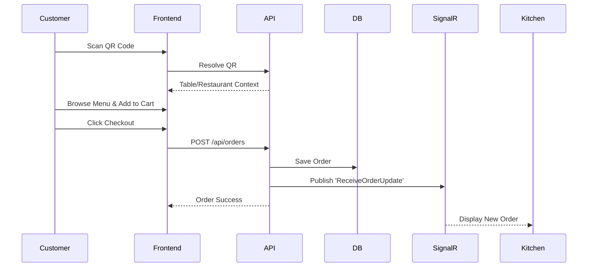

## 30. Complete Restaurant Operational Flow
1. **Admin Setup:** Configures categories, items, and prints QR codes.
2. **Customer Order:** Generates a `Placed` order.
3. **Kitchen:** Acknowledges and cooks (`Preparing` → `Ready`).
4. **Waiter:** Delivers food (`Served`).
5. **Billing:** Customer requests bill; Waiter clears tab and table resets for next patron.

## 31. Data Flow Summary
- **Frontend (Browser):** Ephemeral state (Cart), Cached API responses (React Query), local auth token.
- **Backend (.NET 8):** Stateless processing, SignalR hub connection states, transient memory.
- **PostgreSQL:** Permanent source of truth for all business and relational data.
- **AWS S3:** Permanent source of truth for unstructured media (Menu Images).
- **SignalR:** Transient event bus (no persistent message queuing).

## 32. Flow Dependencies
- **Order Flow** strictly depends on the **QR/Table Flow** to establish identity.
- **Menu Display** strictly depends on the **Restaurant Setup Flow**.
- **Kitchen/Waiter Real-Time Updates** strictly depend on active **SignalR WebSocket connections**.

## 33. Failure Scenarios
- **Invalid QR Token:** Frontend receives `404`; Customer is blocked from ordering.
- **Database Unreachable:** API returns `500` or fails health checks (`/health`).
- **WebSocket Disconnect:** Staff UI will not receive real-time updates. The frontend uses standard SignalR reconnection strategies, but manual page refreshes will pull the latest state via REST.

## 34. Current Flow Limitations
- **SignalR Persistence:** Waiters and Kitchen staff must have an active browser tab open to receive notifications. There is no background push notification fallback (like Apple APNS or Firebase FCM) for devices whose screens are locked.
- **Payment Abstraction:** The lack of a digital payment gateway means all financial settlement flows bypass the software and rely entirely on physical trust/waiter collection.

## 35. Current Production Flow
The verified production flow runs identically to local development but utilizes AWS infrastructure: AWS Amplify hosts the static Vite build, which targets the `.NET 8` API running behind Nginx on AWS Lightsail. Persistent media flows directly to S3. Real-time updates utilize standard WebSockets over HTTPS (`wss://`).
*(Note: As verified from the repository, the architecture is a standard SPA, definitively replacing older documentation claiming an SSR Cloudflare deployment).*
