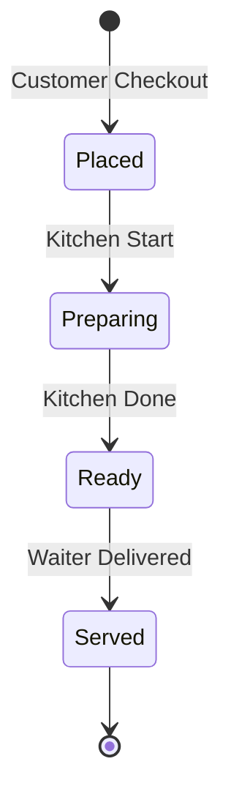
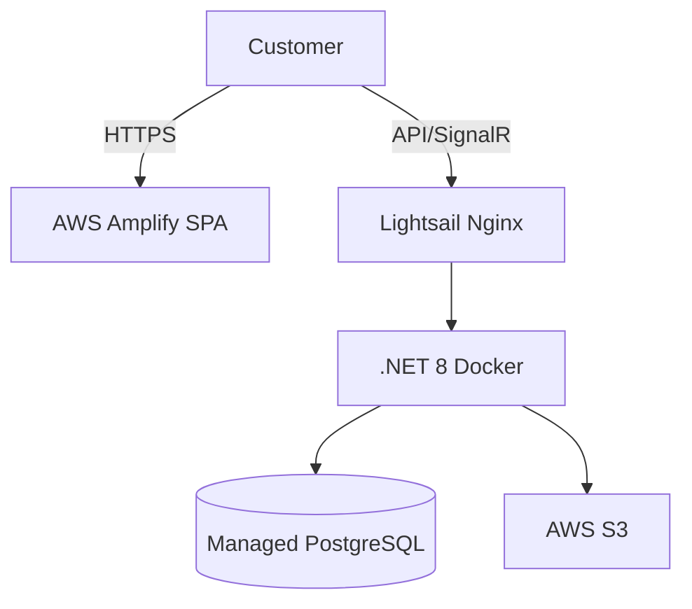
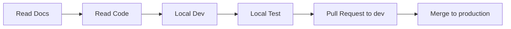

# TABLO — Project Handover Guide

## 1. Handover Purpose
This document is the definitive Ownership Transfer guide for the TABLO project. It is written for a new developer who needs to rapidly understand how to safely set up, maintain, build upon, and deploy TABLO without breaking existing production behavior.

## 2. Project Overview
TABLO is a multi-tenant, real-time QR ordering system for restaurants. 
- **The Problem:** It replaces physical menus and traditional waiter ordering with a contactless, digital experience.
- **Target Users:** Diners (Anonymous), Waiters, Kitchen Staff, Restaurant Managers, and System SuperAdmins.
- **Core Capabilities:** Restaurant onboarding, menu management, QR code generation, real-time order tracking (SignalR), and table service requests.

## 3. Current Project Status
- **Status:** Actively deployed to production.
- **Major Implemented Modules:** SuperAdmin Dashboard, Restaurant Management, Menu/Category Builder, QR Generation, Customer Cart/Checkout, Kitchen live-board, Waiter live-board.
- **Known Limitations:** 
  - No external digital payment provider (e.g., Stripe) is currently integrated. All billing is handled physically by waiters natively.
  - SignalR requires an active open browser tab; there are no background push notifications (APNS/FCM) for locked devices.
- **Deferred Work:** Automated CI/CD for the backend Lightsail deployment.

## 4. Technology Stack

| Component | Technology | Verified |
| :--- | :--- | :--- |
| **Frontend** | React 19, Vite, TanStack Router, TailwindCSS | Yes |
| **Backend** | ASP.NET Core 8 Web API | Yes |
| **Database** | PostgreSQL, Entity Framework Core 8 | Yes |
| **Storage** | AWS S3 (Production) / Local wwwroot (Dev) | Yes |
| **Authentication** | JWT (JSON Web Tokens), BCrypt | Yes |
| **Real-time** | SignalR (WebSockets) | Yes |
| **Frontend Hosting** | AWS Amplify | Yes |
| **Backend Hosting**| Docker, Nginx, AWS Lightsail (Ubuntu) | Yes |

## 5. Repository Structure
The repository (`D:\Projects\tablo`) is structured securely:
- `tablo/` — The complete Vite React SPA frontend.
- `Tablo.Api/` — The complete ASP.NET Core 8 backend.
  - `Controllers/` — HTTP Endpoints.
  - `Entities/` — Database Models & Tenant definitions.
  - `Services/` — Business Logic.
  - `Migrations/` — EF Core schema snapshots.
- `docs/` — Authoritative project documentation.
  - `architecture/` — Technical specs.
  - `flows/` — Business and system flows.
  - `deployment/` — Production instructions.

## 6. Development Environment Requirements
- **OS:** Windows / Linux / macOS
- **Node.js:** v18+ (verified via `npm`)
- **.NET SDK:** 8.0
- **Database:** PostgreSQL 14+ (Local instance required for development)
- **Git:** Required for version control.

## 7. Local Project Setup

```mermaid
graph LR
    Clone[Clone Repo] --> NPM[npm install (tablo/)]
    NPM --> DB[Create Local Postgres DB]
    DB --> EF[dotnet ef database update]
    EF --> RunAPI[dotnet run (Tablo.Api)]
    RunAPI --> RunVite[npm run dev (tablo/)]
```

**Step-by-Step:**
1. `git clone <repository_url>`
2. `cd tablo && npm install`
3. `cd ../Tablo.Api && dotnet restore`
4. Set your local connection string in `Tablo.Api/appsettings.Development.json`.
5. Run `dotnet ef database update` in the `Tablo.Api` directory to seed the schema.
6. Run `dotnet run` (API starts on `http://localhost:5000`).
7. In a new terminal, `cd tablo && npm run dev` (Frontend starts).
8. Verify health at `http://localhost:5000/health`.

## 8. Frontend Development
- **Entry Point:** `tablo/index.html` → `src/main.tsx`.
- **Framework:** React SPA built with Vite.
- **Routing:** TanStack Router (`src/routes`).
- **State/API:** React Query (`@tanstack/react-query`) interacting with custom API clients.
- **SignalR:** `@microsoft/signalr` is used in custom hooks (`useOrderRealtime`).
- **Environment:** Driven by `.env` files. `VITE_API_URL` dictates where the UI sends requests.
*(Note: Older documentation claiming Cloudflare/Nitro SSR is officially obsolete and must be ignored).*

## 9. Backend Development
- **Entry Point:** `Program.cs` (contains all DI registrations, Middleware, and CORS policies).
- **Architecture:** Standard Controller-Service-Repository pattern.
- **EF Core:** `ApplicationDbContext` manages connections to PostgreSQL.
- **Validation:** Relies heavily on DataAnnotations in `DTOs/`.
- **Authentication:** Custom JWT bearer configuration.

## 10. Database Development
- **Database:** PostgreSQL.
- **ORM:** Entity Framework Core.
- **Migrations:** Managed explicitly. `dotnet ef migrations add <Name>` generates code.
- **Tenant Isolation:** Virtually every table (except `Restaurant` and `Employee` SuperAdmins) contains a `RestaurantId`. 
**CRITICAL:** Developers must NEVER expose a global query without filtering by `RestaurantId`.

## 11. Authentication & Authorization
- **Login:** Returns a stateless JWT.
- **Claims:** JWTs embed `Role` and `RestaurantId`.
- **Authorization:** Enforced via `[Authorize(Roles = "Admin,Kitchen,Waiter")]` attributes on controllers.
- **Protection:** API routes immediately reject missing or invalid tokens with `401 Unauthorized`.

## 12. Multi-Tenancy
**This is the most critical security boundary.**
TABLO uses logical multi-tenancy. A single database holds data for all restaurants.
- **Rule:** Every operational controller action must begin by extracting the `RestaurantId` from the JWT and validating it against the requested resource.
- **Example:** `if (User.GetRestaurantId() != request.RestaurantId) return Forbid();`
- **Mistake to Avoid:** Never write a database query like `_context.Orders.ToList()` without `.Where(o => o.RestaurantId == currentTenantId)`.

## 13. Core Business Modules

### Restaurant Management
SuperAdmins provision tenants.

### Menu
Restaurant Admins build Categories and Menu Items. Includes S3 image integration.

### Tables & QR
Admins define tables. The system generates secure, cryptographically random QR tokens.

### Customer Ordering & Cart
Customers scan QRs, browse menus, and maintain ephemeral frontend carts.

### Orders
Checkout transitions the cart into a physical database `Order` with associated `OrderItems`.

### Kitchen
Listens to SignalR. Progresses orders (`Placed` → `Preparing` → `Ready`).

### Waiter & Service Requests
Listens to SignalR. Delivers food (`Ready` → `Served`) and clears tables.

### Billing
Waiters sum up non-cancelled orders for a table to collect physical payment.

## 14. Order Lifecycle



## 15. Real-Time Communication
- **SignalR Hub:** `/hubs/order`
- **Authentication:** Because WebSockets don't natively support standard HTTP headers in browsers, the frontend passes `?access_token=<JWT>` in the connection string, which `Program.cs` intercepts.
- **Events:** `ReceiveOrderUpdate`. Nginx handles the `Connection: Upgrade` header in production.

## 16. Image Storage
- **Abstraction:** `IImageStorageService`.
- **Dev:** `LocalImageStorageService` saves to `wwwroot/images`.
- **Prod:** `S3ImageStorageService` uploads securely to AWS S3 and returns the public CDN URL.

## 17. Production Architecture



## 18. AWS Infrastructure
- **AWS Amplify:** Hosts the React frontend automatically from the `production` branch.
- **AWS Lightsail:** An Ubuntu VM hosting Nginx and the Dockerized backend.
- **AWS S3:** A bucket configured for public read, but restricted programmatic write.

## 19. Production Configuration
Located securely on the production server (e.g., `.env`). NEVER committed to Git.
- `ConnectionStrings__DefaultConnection`
- `Jwt__Key`
- `ImageStorage__S3__BucketName`
- `SuperAdmin__Username`

## 20. Deployment
- **Frontend:** Push to the `production` GitHub branch. Amplify handles the rest.
- **Backend:** SSH into Lightsail, pull `production`, `docker build`, and `docker run`.
*(For detailed steps, see `docs/deployment/PROJECT_DEPLOYMENT_DOCUMENTATION.md`).*

## 21. Database Migrations
Migrations are strictly manual in production to prevent scaling locks.
1. Apply locally.
2. Commit `Migrations/` files to Git.
3. On production, temporarily export the DB connection string.
4. Run `dotnet ef database update`.
*(See `docs/infrastructure/TABLE_QR_MIGRATION_PROCEDURE.md`).*

## 22. Git Workflow
- `dev` branch: Daily development and feature integration.
- `production` branch: Verified stable code. Merging to `production` triggers the live frontend Amplify build.

## 23. Testing
- Health testing available via `/health`.
- Standard xUnit / integration testing patterns apply for the backend.
- **Python E2E Testing:**
  - The repository contains basic Python testing scripts (e.g., `test_api.py`, `test_ws.py`, `test_ws2.py`, `test_ws3.py`).
  - **Dependencies:** They rely solely on the standard library (`urllib`, `json`, `socket`). No `requirements.txt` exists and no `pip install` is required. A virtual environment is optional.
  - **Execution:** Run directly via Python (e.g., `python test_api.py`).
  - **Configuration:** Scripts contain hardcoded endpoints targeting either local (`127.0.0.1:8080`) or specific production IPs (`13.126.116.187`).
  - **Credentials:** Real credentials (e.g., replacing `<SUPERADMIN_PASSWORD_HERE>`) must be manually injected into the scripts prior to execution.

## 24. Production Verification
After deployment:
1. Verify Amplify deployed the latest hash.
2. Verify API `/health`.
3. Test a QR Code scan on a mobile device.
4. Test real-time SignalR by placing a dummy order.

## 25. Troubleshooting

### Frontend won't load
Check Amplify build logs for `npm run build` failures.

### API unavailable / 502 Bad Gateway
SSH into Lightsail. Run `docker ps` to ensure the container is running. Run `docker logs tablo-api`.

### Database connection failure
Verify `ConnectionStrings__DefaultConnection` in the server's environment variables.

### CORS failure
Ensure the backend `AllowedOrigins` exactly matches the AWS Amplify production domain.

### SignalR failure
Verify Nginx is correctly configured to proxy the `Upgrade` and `Connection` headers for `/hubs/order`.

### S3 image failure
Verify the AWS IAM user credentials injected into the backend have `s3:PutObject` permissions.

## 26. Security Rules
- **NEVER** commit `appsettings.Development.json` or `.env` files.
- **NEVER** bypass `User.GetRestaurantId()` validation.
- **NEVER** execute `dotnet ef database update` in production without verifying the target DB string.

## 27. Things a New Developer MUST NOT Do
- **DO NOT** change tenant isolation logic casually. A mistake here leaks data to competitors.
- **DO NOT** directly modify production database data via SQL. Use the Admin UI.
- **DO NOT** assume historical markdown files are accurate. Always trust the C# and React code first.
- **DO NOT** run migrations on startup in `Program.cs`.

## 28. Safe Change Workflow



## 29. Known Limitations
- The system fundamentally assumes the Waiter handles actual monetary exchange.
- Offline behavior is not supported.

## 30. Deferred Work
- AWS ECR / GitHub Actions integration for backend Docker deployments.

## 31. Emergency Recovery
If the server is compromised or destroyed:
1. Provision a new Ubuntu VM.
2. Install Docker & Nginx.
3. Pull `production`.
4. Restore the `.env` configuration from secure password storage.
5. Rebuild and map Nginx.
*(The managed PostgreSQL database is independent of the compute VM).*

## 32. Handover Checklist
- [ ] I understand the SPA frontend architecture.
- [ ] I understand the .NET 8 Docker backend architecture.
- [ ] I understand how `RestaurantId` strictly enforces multi-tenancy.
- [ ] I understand how to run EF Core Migrations safely.
- [ ] I understand how AWS Amplify and Lightsail are used.
- [ ] I have successfully run the project locally.

## 33. Important Documentation References
- **`PROJECT_TECHNICAL_DOCUMENTATION.md`**: Deep dive into code and architecture.
- **`PROJECT_FLOW_DOCUMENTATION.md`**: Detailed step-by-step business flow and lifecycles.
- **`PROJECT_DEPLOYMENT_DOCUMENTATION.md`**: Step-by-step production VM and CDN deployment.

## 34. Quick Start for New Developer
1. **Repository:** Clone from `production` branch.
2. **Local Run:** `dotnet run` (backend) + `npm run dev` (frontend).
3. **Docs:** Read Technical, Flow, and Deployment docs in the `docs/` folder.
4. **Golden Rule:** Never modify tenant isolation, and never commit secrets.

## 35. Final Handover Notes
You now own the TABLO codebase. It is a stable, strictly-isolated multi-tenant application. Prioritize preserving existing workflows, enforcing database security, and ensuring zero-downtime updates via stateless Docker deployments. Welcome to TABLO.
